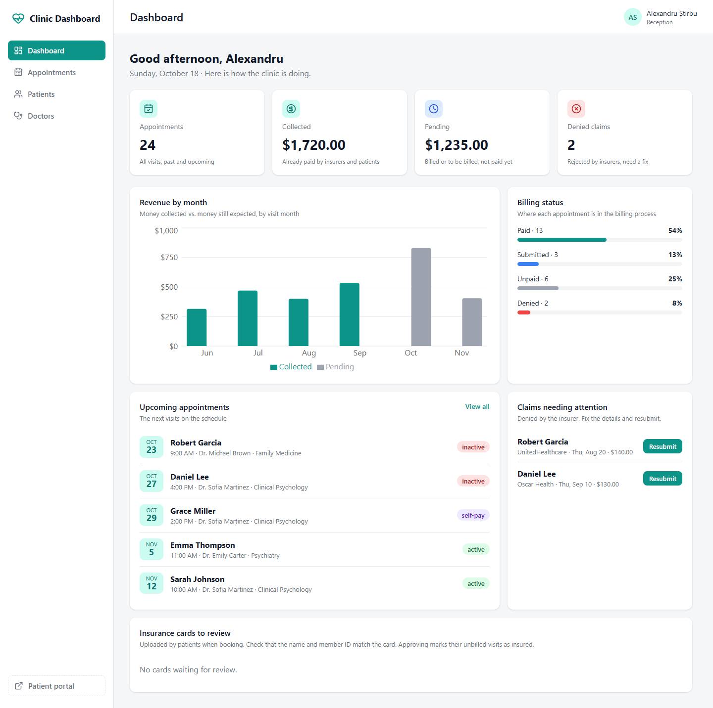
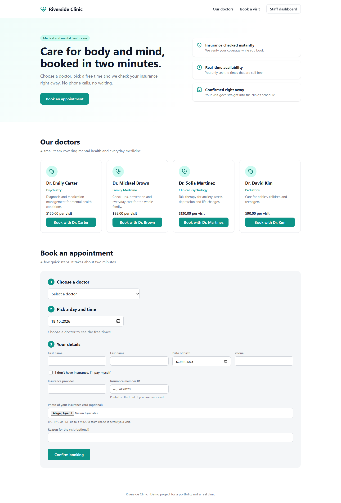
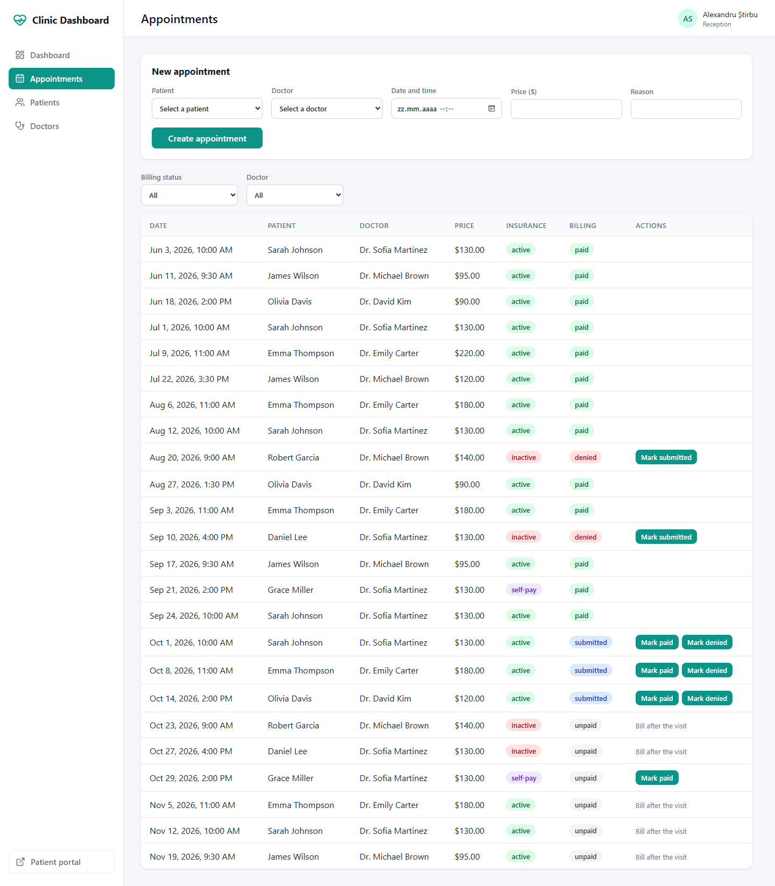

# Clinic Dashboard

A full-stack web app for a small medical and mental health clinic: a **public patient portal** for online booking and a **staff dashboard** for scheduling, insurance checks and billing.

It models the back-office work of a US clinic: insurance eligibility, the insurance claim lifecycle (submitted → paid / denied), self-pay patients and revenue reporting.

> Demo project. The insurance check and the card payment are simulated, and there is no login.



## Features

**Patient portal** (`/`)
- Browse doctors with their specialty and visit price
- Book online in a few steps: doctor → day → free time slot → personal and insurance details
- Only free slots are shown, and a slot can't be booked twice (409 Conflict)
- Insurance is checked instantly when booking; patients can upload a photo of their insurance card
- Patients without insurance can pay by card now (demo payment) or at the clinic

**Staff dashboard** (`/admin`)
- Key numbers: appointments, money collected, money pending, denied claims
- Revenue by month chart (collected vs. pending) and billing status distribution
- Upcoming appointments and denied claims that need to be resubmitted
- Review of uploaded insurance cards: approving or rejecting overrides the automatic check
- Appointments list with filters by billing status and doctor, and billing actions
- Patients and doctors management

| Patient portal | Appointments |
| --- | --- |
|  |  |

## Tech stack

| Part | Technologies |
| --- | --- |
| Backend | Python 3.14, FastAPI, SQLAlchemy 2 (ORM), Pydantic 2, SQLite |
| Frontend | React 19, TypeScript, Vite, React Router, Recharts, lucide-react |
| Tests | pytest, FastAPI TestClient (in-memory database) |

## Architecture

```
clinic-dashboard/
├── backend/
│   ├── app/
│   │   ├── main.py            FastAPI app, CORS, routers
│   │   ├── database.py        engine, session, get_db dependency
│   │   ├── models.py          SQLAlchemy models: Patient, Doctor, Appointment
│   │   ├── schemas.py         Pydantic schemas (request / response shapes)
│   │   ├── routers/           HTTP endpoints, one file per resource
│   │   ├── insurance.py       eligibility check (mock of an external API)
│   │   ├── billing.py         billing state machine and visit prices
│   │   ├── scheduling.py      opening hours, slots, double-booking check
│   │   ├── insurance_cards.py card upload and staff review
│   │   ├── payments.py        fake payment provider (Stripe-like)
│   │   └── seed.py            demo data
│   └── tests/
└── frontend/
    └── src/
        ├── main.tsx           routes: / (portal) and /admin (staff)
        ├── App.tsx            staff app: shared state and pages
        ├── api.ts             every call to the backend
        ├── types.ts           TypeScript types matching the API schemas
        ├── pages/             PatientPortal, DashboardPage
        └── components/        tables, forms, charts, panels
```

The routers only handle HTTP. Business rules live in their own modules (`billing.py`, `scheduling.py`, `insurance.py`…), so they can be tested without the API and replaced without touching the endpoints.

## Business rules

**Billing state machine.** Insured visits follow the insurance claim lifecycle:

```
unpaid → submitted → paid
              ↓
           denied → submitted (resubmitted)
```

- A claim can only be submitted **after** the visit took place.
- Any other transition (for example `unpaid → paid`) returns **400**; an unknown status returns **422**.
- Self-pay visits skip the claim: `unpaid → paid`.

**Insurance.** The eligibility check is a mock: supported providers are active, unless the member ID ends in `0`. Staff review of an uploaded card overrides the automatic result for visits that were not billed yet.

**Scheduling.** The clinic offers one-hour slots from 9:00 to 17:00. Two appointments with the same doctor less than an hour apart are rejected with **409 Conflict**.

**Payments.** Card data never reaches the backend. A fake payment provider in the browser validates the card (Luhn check, expiry, CVC) and returns a token; the backend only charges the token, like with Stripe. If the payment is declined (**402**), nothing is saved.

## Running it locally

Requirements: Python 3.12+ and Node.js 22+.

**Backend** (http://127.0.0.1:8000, API docs at `/docs`)

```bash
cd backend
python -m venv venv
venv\Scripts\activate          # macOS / Linux: source venv/bin/activate
pip install -r requirements.txt
python -m app.seed             # creates clinic.db with demo data
uvicorn app.main:app --reload
```

**Frontend** (http://localhost:5173)

```bash
cd frontend
npm install
npm run dev
```

- Patient portal: http://localhost:5173/
- Staff dashboard: http://localhost:5173/admin

**Demo payment cards:** `4242 4242 4242 4242` succeeds, `4000 0000 0000 0002` is declined. Use any future expiry date and any CVC.

## Tests

```bash
cd backend
pip install -r requirements-dev.txt
pytest
```

34 tests cover the business rules (eligibility, billing transitions, slots) and the API flows: booking, double booking, claim lifecycle, statistics, self-pay card payments and insurance card review. Each test runs on its own in-memory database.

## Design decisions

- **Money is stored as integer cents** to avoid floating-point rounding errors; it is formatted as dollars only in the UI.
- **Statistics are calculated in SQL** (`GROUP BY`, and `SUM(CASE …)` for monthly revenue), so the API returns totals instead of every appointment.
- **Separate Create and Read schemas**: clients can't set server-controlled fields such as the ID or the billing status.
- **SQLite for simplicity.** Thanks to SQLAlchemy, switching to PostgreSQL means changing the database URL and the driver (the monthly query would use `date_trunc` instead of `strftime`).

## What I would add next

- Authentication with roles (front desk, billing team) and protected admin routes
- Editing a patient's insurance details before resubmitting a denied claim
- Generated documents: invoices for self-pay patients and CMS-1500 claims for insurers
- A real eligibility API and Stripe instead of the mocks
- PostgreSQL, database migrations (Alembic) and encrypted storage for insurance cards
